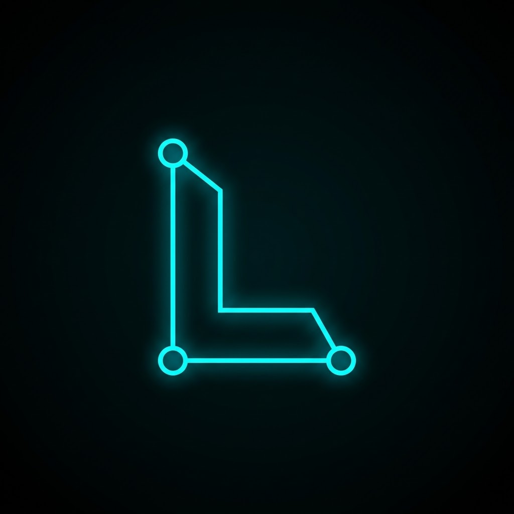
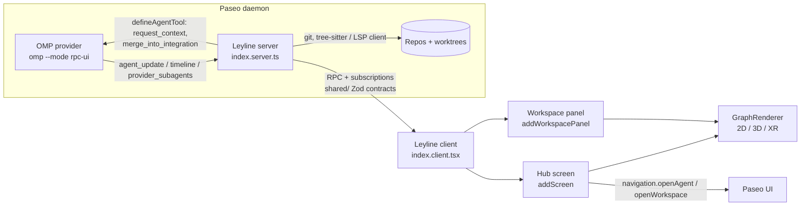

<p align="center">
  
</p>

# Leyline

**A visual hub for multi-repo, multi-agent development — a [Paseo](https://github.com/getpaseo/paseo) plugin powered by [OMP (oh-my-pi)](https://github.com/can1357/oh-my-pi).**

Leyline renders a live, interactive graph of everything in flight across your projects: repositories, branches, local worktrees, the agents (and their subagents) working in each, the context they share with one another, and the integration points where their work converges. 2D and 3D physics-based views, with VR interaction as a later goal.

> Status: pre-alpha. Plugin scaffold loads in Paseo and renders a three.js WebGL scene; live data not wired yet. See [Development Phases](#development-phases).

## Why

Working on many projects at once with agentic development produces a lot of simultaneous state that text UIs flatten:

- Several git repos, each with multiple branches and local worktrees.
- Several agent contexts per repo, each able to spin up subagents.
- Agents on different branches of the same repo that need to know about each other's context.
- An **integration worktree** workflow: feature branches are merged into one integration branch to test the full feature arc before PRs are opened.
- PRs and GitHub tasks that the branches eventually map to (follow-up scope).

Paseo already manages daemons, workspaces (one worktree each), agents, terminals, and git/GitHub runtime state; OMP already provides the agent engine with subagents, worktree isolation, and a rich event stream. Leyline sits on top of both and adds two things: a **visual language** for this complexity, and **new ways to connect agents** that the hosts don't provide yet (context brokering, integration-branch merges).

## Scope

| Area | In scope | Notes |
|---|---|---|
| Visual hub | Cross-project graph: hosts → repos → branches/worktrees → agents → subagents → touched files | Full-page screen, not tied to one workspace |
| Per-workspace view | Same graph filtered to one worktree, opened from the workspace "+" tab menu | `addWorkspacePanel` |
| Agent state | Idle / Thinking / Executing, current tool & file, pending permissions, attention | From Paseo agent + timeline subscriptions |
| Git topology | Branch, ahead/behind, dirty, repo-root ↔ worktree, PR state/checks | From Paseo `gitRuntime` / `githubRuntime` |
| Agent interconnection | Context-sharing edges; "ask agent X for context" and "merge into integration" as plugin-provided agent tools | New capability, built on `defineAgentTool` + `agents.ref(id).send` |
| Integration branch | Visual merge targets; trigger merges into the integration worktree | Plugin RPC running `git` server-side |
| Code graph | Files/symbols/imports inside a worktree (the original "leylines") | Own extractor; OMP exposes no LSP server |
| PR / GitHub tasks | Nodes for PRs, issues, checks | Follow-up feature |
| Rendering | 2D + 3D force-directed, one data model; VR later | See [Graph component evaluation](#graph-component-evaluation) |

Leyline **observes and brokers**; it does not launch agents itself. Agents stay owned by Paseo.

**Provider dependency.** Paseo has no hard dependency on OMP; it also drives Claude, Codex, Copilot, OpenCode and Pi. Leyline consumes Paseo's provider-normalised surfaces (`agents.list`, timeline `tool_call` items, `provider_subagents` events, hooks) and is therefore provider-agnostic by default. A hard OMP dependency is acceptable where an OMP feature is genuinely invaluable; none has been identified yet — the candidates (subagent trees, worktree isolation, `AGENTS.md`/`RULES.md` conventions) are all reachable through Paseo or the filesystem.

## Technology stack

| Layer | Choice | Notes |
|---|---|---|
| Host | Paseo plugin API (`@getpaseo/plugin`) | Experimental API; panels need Paseo ≥ 0.13, hooks ≥ 0.14. Developed against 0.15.2. |
| Agent engine | Provider-agnostic via Paseo; OMP (oh-my-pi) is the primary target | Paseo ships a native OMP provider (`omp --mode rpc-ui`, JSONL over stdio). Developed against omp 18.16.0; Paseo requires ≥ 16.3.9. |
| Renderer | **three.js** (imperative, `import("three")` behind the web gate) — [ADR-001](docs/ADR-001-renderer.md) | Spike verified: three r187 renders WebGL 2.0 inside a Paseo 0.15.2 panel on Electron |
| Physics | `d3-force-3d` (1D/2D/3D from one simulation) | Common to all three candidates |
| Styling | Paseo `PluginTheme` tokens + injected CSS | Dark-mode first, neon/cyan to match the Leyline logo |
| Language | TypeScript, React (React Native Web on desktop) | Node 22 / npm |

## How it fits together



## Proposed project structure

Mirrors the layout produced by `paseo plugin init`. The plugin compiler enforces the directory boundary: `client/` ships only to the app bundle, `server/` only to the daemon, `shared/` to both. Extra root-level modules are a compile error.

```
Leyline/
├── paseo-plugin.json        # manifest: id, name, icon (PNG), requirements.paseo
├── package.json             # deps: three / d3-force-3d (or react-force-graph), zod
├── tsconfig.json            # no DOM lib — DOM access only inside web-gated modules
├── index.client.tsx         # contribute(client): addScreen (hub), addWorkspacePanel, addSidebarHeaderItem, addCommandCenterItem
├── index.server.ts          # contribute(server): handle(rpc), addHook(...), defineAgentTool(...), subscriptions
├── shared/
│   ├── graph.ts             # renderer-agnostic model: GNode / GLink / GraphPatch (Zod)
│   └── contracts.ts         # defineRpc() schemas: graph snapshot + patches, actions (merge, send context)
├── client/
│   ├── hub/                 # HubScreen: cross-host, cross-project graph (usePaseo().workspaces/agents.list({subscribe}))
│   ├── panel/               # WorkspacePanel: graph scoped to one worktree; native (iOS/Android) list fallback
│   ├── renderer/            # web-only: GraphRenderer interface + impl(s); mode 2d | 3d | xr
│   ├── web.ts               # Platform.OS === "web" gate; lazy require of WebGL deps, CSS injection
│   └── mock/                # Phase 1 static fixtures
├── server/
│   ├── topology/            # Paseo state → graph: hosts, repos, worktrees, agents, subagents, PRs
│   ├── codegraph/           # repo → files/symbols/imports (tree-sitter or LSP client); cache + invalidation
│   ├── broker/              # agent tools: leyline_request_context, leyline_merge_into_integration
│   └── git/                 # merge / status helpers for the integration-branch workflow
├── assets/
│   └── icon.png             # directed "L" logo
├── docs/                    # DESIGN.md, ADRs (renderer decision goes here)
├── LICENSE                  # MIT
└── README.md
```

## Integration findings

From Paseo/OMP docs and the local installs unless marked `[INFERENCE]`. Sources: [plugin reference](https://paseo.sh/docs/plugins/reference), [hooks](https://paseo.sh/docs/plugins/hooks), [SDK reference](https://paseo.sh/docs/sdk/reference), [SDK events](https://paseo.sh/docs/sdk/events), `getpaseo/paseo@main`.

### Surfaces

- **Hub (cross-project)**: `client.addScreen({ id, title, Component })` — full-page, no workspace scope; `PluginScreenProps = { theme, host, layout, params, navigation? }`. Opened from `addSidebarHeaderItem` → `openScreen({ screenId, params })`. `useWorkspace` / `useAgent` hooks **throw outside workspace panels**, so the hub reads `usePaseo().workspaces.list({ subscribe: {} })` and `agents.list({ subscribe: {} })` directly (`snapshot` then `workspace_update` / `agent_update` upsert/remove).
- **Per-workspace**: `client.addWorkspacePanel({ id: "leyline", title: "Leyline", icon, locations: ["workspace", "explorer"], Component })`. `locations: ["workspace"]` (default) places Leyline in the workspace **"+" new-tab menu** beside Agent / Terminal / Diff / Browser; `"explorer"` also lists it in the sidebar explorer. `icon` is a Lucide name, `{ svg }`, or component. The `Ctrl+Shift+?` shortcuts on built-in entries are host-owned.
- **Multi-host**: `useHosts()` → `{ serverId, label, status }[]`, `getPaseoClient(serverId)`; or `usePaseo().hosts.list()` / `hosts.client(serverId)` (must `dispose()`).
- **Navigation out**: `navigation.openAgent({ agentId, serverId? })`, `openWorkspace({ workspaceId, serverId? })`, `openBrowser({ url })` (Electron), `client.openPanel(id, { workspaceId, agentId? })`. No call opens the built-in Diff/Terminal tab; no focus-change event exists.
- **Runtime**: client code is **React Native** (RN Web on desktop). Host-provided modules only: `react`, `react-native`, `zod`, `@tanstack/react-query`, `@getpaseo/plugin/*`. Third-party DOM/WebGL libraries work if bundled and lazily `require()`d behind `Platform.OS === "web"`, mounted into a `<View ref>` DOM node (pattern: [`markdown-panel`](https://github.com/getpaseo/paseo/tree/main/plugin-examples/markdown-panel) with CodeMirror). Electron renderer has WebGL (Paseo itself ships `@xterm/addon-webgl`); `contextIsolation: true`, no `--disable-gpu`. `[INFERENCE]` CSS via injected `<style>`; Web Workers via Blob URL since the bundler emits one file.

### What the hub graph is built from today

| Node / edge | Source |
|---|---|
| Host | `useHosts()` / `paseo.hosts.list()` |
| Repo (project) | `projects.list()`; `workspaces.list().emptyProjects`; entry `projectRootPath`, `project.checkout.mainRepoRoot` |
| Worktree / workspace | `workspaces.list({ subscribe: {} })` entry: `workspaceKind` (`directory` \| `local_checkout` \| `checkout` \| `worktree`), `workspaceDirectory`, `worktreeSlug`, `labels`, `status`, `diffStat` |
| Branch state | `gitRuntime: { currentBranch, remoteUrl, isDirty, aheadBehind, aheadOfOrigin, behindOfOrigin, isPaseoOwnedWorktree }` |
| PR (follow-up) | `githubRuntime.pullRequest: { number, url, title, state, baseRefName, headRefName, isMerged, isDraft, mergeable, checks[], checksStatus, reviewDecision }` |
| Agent | `agents.list({ subscribe: {}, filter: { labels, projectKeys } })`: `status` (`initializing` \| `idle` \| `running` \| `error` \| `closed`), `activeTurn`, `workspaceId`, `cwd`, `model`, `pendingPermissions`, `requiresAttention`, `title`, `labels` |
| Agent → parent edge | label `paseo.parent-agent-id` (+ `paseo.parent-server-id` cross-host); not a top-level field |
| OMP subagent nodes | `paseo.observeEvents(["agent.provider_subagents.update"])` → `{ kind: "upsert", subagent: { id, parentAgentId, status, title, toolCallId, cwd? } }` / `timeline` / `remove`. Flat (one level); OMP never sets `parentSubagentId` |
| Files an agent touches | `agents.ref(id).timeline.subscribe(cb)` → `tool_call` items, `detail` carries `read/edit/write.filePath`, `shell.command` |
| Agent state mapping `[INFERENCE]` | Idle = `status: "idle"`; Thinking = streaming `assistant_message` with thinking content; Executing = `tool_call` between start and completion |

### Agent interconnection primitives

- Plugin → agent: `agents.ref(id).send(text)`, `.run(text, { timeoutMs })`, `.waitForFinish()`, `.respondToPermission(...)`, `.timeline.append({ type: "plugin", ... })` (server-side). No steer/interrupt on `PaseoApi`.
- Agent → agent (host-native): Paseo MCP tools / `paseo run` let an agent spawn or prompt other agents by ID; `agents.create({ parent })` sets the parent labels.
- Context injection (server hooks): `agent.create.before` (`systemPrompt`, `mcpServers`), `agent.open.before` (`env`, `tools: defineAgentTool(...)`, `mcpServers`), `agent.turn.before/after` (notification only — cannot modify the turn).
- **Leyline's broker design**: expose plugin agent tools via `defineAgentTool` — `leyline_request_context(agentId)` (returns a summary of another agent's recent timeline/touched files) and `leyline_merge_into_integration(branch)` (server-side `git merge` into the configured integration worktree, result appended to both timelines). Context-sharing edges on the graph are derived from these calls.
- Actions: `workspaces.create({ source: { kind: "worktree", cwd, action: "branch-off", refName, branchName } })`, `workspace.agents.create({ config: { provider: "omp/<model>" }, prompt, title, labels, parent })`, `workspace.terminals.create({ command, args, cwd })`. Hooks `worktree.create.before/after` can rewrite worktree placement and seed files.

### OMP surface

- OMP is an LSP **client**, not a server: no third-party LSP endpoint. The code graph must be extracted by Leyline's server (own LSP client, tree-sitter — OMP ships grammars under `~/.omp/natives/grammars/` — or a lightweight import/symbol parser).
- OMP events reach Leyline through Paseo's OMP provider (`agent_start`, `message_update`, `tool_execution_start/end`, `subagent_*`, `session_settled` → timeline items and `provider_subagent` events). No need to tail `~/.omp/agent/sessions/*.jsonl` while Paseo manages the agent.
- Worktrees: OMP's `task` isolation (`isolated: true`) and `omp worktree` exist, but Paseo creates one worktree per workspace; Leyline clusters by Paseo workspace.
- Memory files: OMP reads `AGENTS.md`, `CLAUDE.md`, sticky `RULES.md`. `DESIGN.md` is not built-in — add it to `contextFiles.extra` or `@docs/DESIGN.md` inside `AGENTS.md`. Node quick-views read these from disk.

## Graph component evaluation

Requirement: one data model driving 2D and 3D force-directed views, custom node visuals, grouping (repo / worktree clusters), a credible path to VR, loadable inside the RN-Web plugin runtime. Verified Nov 2026.

| Library | License | 2D | 3D | Physics | Custom nodes | Clusters | VR / XR | gz size | Notes |
|---|---|---|---|---|---|---|---|---|---|
| **three.js DIY** (+ `d3-force-3d`, optionally r3f, reuse `three-forcegraph`) | MIT | Ortho camera + 2-D sim | Yes | d3-force-3d | Meshes, `InstancedMesh`, sprites, troika text; HTML via `CSS2DRenderer` (not in XR) | Own (`forceCluster`, hull meshes) | **Best**: `renderer.xr` + `VRButton` / `@react-three/xr`, same scene | ~170 KB (three) | Most work, most control; one code path for 2D/3D/VR |
| **react-force-graph** `-2d` / `-3d` / `-vr` | MIT | Canvas | three | d3-force-3d / ngraph, DAG modes | `nodeCanvasObject` (2D), `nodeThreeObject` (3D) | Via `d3Force` + `d3-force-cluster-3d` | `-vr` is A-Frame (page-owning); 3D uses rAF, no in-place WebXR | 57 KB / 403 KB | Fastest to ship; 2D/3D are separate components (sim state lost on switch) |
| **reagraph** | Apache-2.0 | Yes | Yes | d3-force-3d, FA2, tree, radial | `renderNode` (r3f JSX), troika labels | Built-in `clusterAttribute`, collapse | None; owns the `<Canvas>` | 385 KB | Best DX for 2D↔3D toggle in one component; smaller community |
| `@xyflow/react` | MIT | DOM/SVG | None | d3-force via example | React components (best) | Sub-flows | None | 60 KB + CSS | Right only if rich HTML cards outrank 3D; a second renderer, not a stepping stone |
| sigma.js + graphology | MIT | WebGL | None | ForceAtlas2 (worker) | WebGL programs, no HTML | None | None | 97 KB | 10k–100k nodes |
| `@cosmos.gl/graph` | MIT | WebGL2 | None | GPU force | Shapes only | Cluster force | None | 137 KB | 100k–1M nodes; Float32Array API |
| `@antv/g6` v5 | MIT | Yes | Extension 0.x | Many | React nodes via ext | Combos | None | 400 KB | 3D is 0.x |
| cytoscape.js | MIT | Canvas | None | cose/fcose | Stylesheet | Compound nodes | None | 137 KB | |
| vis-network | Apache-2 / MIT | Canvas | None | Built-in | Shapes | Cluster collapse | None | 118 KB | |

**Ranking**

1. **three.js DIY** (r3f + `d3-force-3d`, reusing `three-forcegraph` as the graph `Object3D`) — the only option with one scene for 2D (orthographic camera, 2-D simulation), 3D, and VR. What you re-own vs `react-force-graph`: controls, raycast picking/hover, tooltips, `zoomToFit`, prop diffing (`[INFERENCE]` ~300–600 LOC). HTML-rich node content (diff previews, `AGENTS.md`) becomes a DOM overlay positioned from the projected node, or a side panel.
2. **react-force-graph-2d + -3d** — same data model, quickest Phase 1. Migration to (1) is natural because `three-forcegraph` is what it wraps.
3. **reagraph** — single-component 2D/3D toggle + clustering out of the box; no XR hook, heaviest bundle.

**VR reality check**: stock Electron does **not** ship OpenXR (`checkout_openxr: False` in Electron's DEPS; [electron#35011](https://github.com/electron/electron/issues/35011) open since 2022). VR from the Paseo desktop app is not realistic; the practical path is serving the same renderer bundle to a WebXR-capable browser (Chrome/Edge on Windows OpenXR, Quest browser) via `navigation.openBrowser`. Design the renderer so this is a deployment choice, not a rewrite.

**Abstraction** (decided regardless of library):

```ts
// shared/graph.ts
type GNode = { id: string; kind: "host" | "repo" | "branch" | "worktree" | "agent" | "subagent" | "file" | "pr";
               group?: string; state?: string; x?: number; y?: number; z?: number; fx?: number; fy?: number; fz?: number };
type GLink = { id: string; source: string; target: string;
               kind: "contains" | "branch-of" | "merges-into" | "spawned" | "shares-context" | "touches" };
type GraphPatch = { upsertNodes?: GNode[]; removeNodes?: string[]; upsertLinks?: GLink[]; removeLinks?: string[] };

// client/renderer/renderer.ts — one interface, swappable impls
interface GraphRenderer {
  mount(el: HTMLElement): void;
  apply(patch: GraphPatch): void;        // keep node object identity stable so d3-force keeps positions
  setMode(mode: "2d" | "3d" | "xr"): void;
  on(ev: "select" | "hover" | "dragEnd", cb: (id: string) => void): void;
  fit(): void;
  dispose(): void;
}
```

## Development phases

### Phase 1: Foundation & renderer spike
- [x] Investigate Paseo plugin API, OMP integration surfaces, hub-level data, graph libraries
- [x] Repository scaffolding: README, `.gitignore`, MIT license
- [x] `paseo plugin init`; sidebar header item + hub screen + workspace panel registered
- [x] **Bundling spike**: three.js scene mounted in a Paseo workspace panel; WebGL 2.0, resize, `three/addons` subpath export verified. `require("three")` fails (`process.emitWarning`), dynamic `import()` works
- [x] Decide renderer: three.js DIY — [ADR-001](docs/ADR-001-renderer.md)
- [ ] Mock topology fixtures (hosts, repos, worktrees, agents, subagents) rendered in 2D and 3D
- [x] Leyline logo (directed "L"): `assets/icon.png` in the manifest, monochrome SVG (`client/logo.ts`) as the sidebar item and panel icon

### Phase 2: Live topology
- [ ] `server/topology`: `workspaces.list` / `agents.list` subscriptions + `provider_subagents` events → `GraphPatch` stream over a plugin subscription
- [ ] Agent state (Idle / Thinking / Executing), current tool/file from timeline `tool_call` items
- [ ] Repo-root ↔ worktree, branch, ahead/behind, dirty, parent-agent edges
- [ ] Click-through: `navigation.openAgent` / `openWorkspace`

### Phase 3: Interconnection & integration branch
- [ ] `defineAgentTool`: `leyline_request_context`, `leyline_merge_into_integration`
- [ ] Integration worktree as a merge-target node; `merges-into` edges; server-side `git merge` with result reporting
- [ ] `shares-context` edges derived from broker calls; node quick-views for `AGENTS.md` / `DESIGN.md` and diffs
- [ ] Drag-and-drop: task/branch node onto agent node → `workspace.agents.create({ prompt, parent })`

### Phase 4: Code graph & polish
- [ ] `server/codegraph`: files / symbols / imports per worktree (tree-sitter or LSP client) as an expandable sub-graph
- [ ] Clustering forces per repo / worktree; LOD for large graphs
- [ ] Dark-mode styling, neon/cyan theme, animation (pulse on active agents)

### Later
- [ ] PR / issue / checks nodes from `githubRuntime`
- [ ] VR mode (aspirational): serve the renderer to a WebXR browser; `@react-three/xr` or `VRButton`

## Open questions

- **`three-forcegraph` / `d3-force-3d`** under Paseo's bundler — three itself is verified; these two are not yet.
- **Plain-browser URL for a panel** (needed for the VR path) — not found in docs.
- **Missing host APIs** (candidate feature requests): checkout status / commits / diff / merge / push and `listProviderSubagents` exist on `DaemonClient` but not `PaseoApi`; no merge-base / branch-graph API; no "open Diff tab" navigation; no steer/interrupt; `useWorkspace`/`useAgent` unusable in screens; `agent.turn.before` cannot inject context.
- **Paseo license** is a custom text (not MIT/Apache); confirm redistribution terms before publishing to the Paseo plugin registry.

## Getting started (once scaffolded)

```sh
npm install
npm run typecheck
paseo plugin install "$(pwd)"
paseo plugin reload leyline
paseo plugin logs leyline
```

Prerequisites: Paseo ≥ 0.13 with plugins enabled (Settings → Plugins), OMP ≥ 16.3.9 with the OMP provider enabled in `~/.paseo/config.json`.

## License

[MIT](./LICENSE) — the standard for React-based tooling; permissive enough to maximize contribution and adoption.
