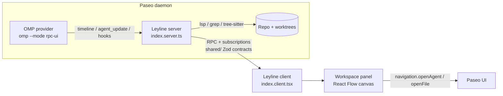

# Leyline

**A Visual Agent Orchestration & Code Graph Plugin for [Paseo](https://github.com/getpaseo/paseo).**

Leyline bridges text-based AI agent execution and visual codebase architecture. It renders a live, interactive node-based map of the codebase and the agents working on it, using [OMP (oh-my-pi)](https://github.com/can1357/oh-my-pi) as the agent engine and the codebase's semantic structure as the map.

> Status: pre-alpha. Investigation complete; no plugin code yet. See [Development Phases](#development-phases).

## Core objective

A developer-centric visual canvas to orchestrate, monitor, and interact with multiple live coding agents working in parallel Git worktrees.

## Features (planned)

- **Semantic codebase mapping** — an auto-updating graph of files, symbols, and dependencies (the "leylines" of the code).
- **Live agent tracking** — active OMP agents as distinct nodes; shows the file/module each one is reading or modifying.
- **Worktree visualization** — isolated Git worktrees rendered as spatial clusters, so parallel tasks don't clutter the main-branch view.
- **Interactive nodes** — custom React Flow nodes with real-time context: agent state (Idle / Thinking / Executing), quick views of `AGENTS.md` / `DESIGN.md`, inline diff previews.
- **Bi-directional interaction** — clicking a node focuses the Paseo agent panel or file on that context.

## Technology stack

| Layer | Choice | Notes |
|---|---|---|
| Host | Paseo plugin API (`@getpaseo/plugin`) | Experimental API; panels need Paseo ≥ 0.13, hooks ≥ 0.14. Developed against 0.15.2. |
| Agent engine | OMP (oh-my-pi) | Paseo ships a native OMP provider (`omp --mode rpc-ui`, JSONL over stdio). Developed against omp 18.16.0; Paseo requires ≥ 16.3.9. |
| Canvas | React Flow (`@xyflow/react`) | Web/Electron only; loaded behind a `Platform.OS === "web"` gate. |
| Layout | Dagre (or ELK) | Auto-layout as the graph scales. |
| Styling | Paseo `PluginTheme` tokens + injected CSS | Dark-mode first, neon/cyan to match the Leyline logo. |
| Language | TypeScript, React | Node 22 / npm. |

## How it fits together



Leyline **observes** agents that Paseo already manages; it does not launch OMP itself (see [Open questions](#open-questions)).

## Proposed project structure

Mirrors the layout produced by `paseo plugin init`. The plugin compiler enforces the directory boundary: `client/` ships only to the app bundle, `server/` only to the daemon, `shared/` to both. Extra root-level modules are a compile error.

```
Leyline/
├── paseo-plugin.json        # manifest: id, name, icon (PNG), requirements.paseo
├── package.json             # deps: @xyflow/react, dagre, zod
├── tsconfig.json            # no DOM lib — DOM access only inside web-gated modules
├── index.client.tsx         # contribute(client): addWorkspacePanel, addSidebarHeaderItem, addCommandCenterItem
├── index.server.ts          # contribute(server): handle(rpc), addHook(...), subscriptions
├── shared/
│   └── contracts.ts         # defineRpc() schemas: graph snapshot, agent state, worktree list
├── client/
│   ├── panel/               # LeylinePanel (RN shell) + native fallback (list view)
│   ├── canvas/              # web-only: React Flow mount, nodes/, edges/, layout/ (dagre)
│   ├── web.ts               # Platform.OS === "web" gate; lazy require of @xyflow/react, CSS injection
│   └── mock/                # Phase 1 static fixtures (files, agents, leylines)
├── server/
│   ├── graph/               # repo → nodes/edges (symbols, imports); cache + invalidation
│   ├── agents/              # agents.list({subscribe}) + timeline tool_call → agent node state
│   └── worktrees/           # workspaces.list + worktree.create hooks → clusters
├── assets/
│   └── icon.png             # directed "L" logo
├── docs/                    # DESIGN.md, ADRs
├── LICENSE                  # MIT
└── README.md
```

## Integration findings

What the investigation established; everything here is from Paseo/OMP docs or the local installs unless marked `[INFERENCE]`.

### Paseo plugin surface

- Entry points: `index.client.tsx` → `export default function contribute(client: PluginClientContext)`; `index.server.ts` → `contribute(server: PluginServerContext)`. Both return cleanup functions.
- Canvas home: `client.addWorkspacePanel({ id: "leyline", title: "Leyline", icon, locations: ["workspace", "explorer"], Component })`. `locations: ["workspace"]` (the default) is what puts **Leyline in the workspace "+" new-tab menu** next to Agent / Terminal / Diff / Browser; `"explorer"` additionally lists it in the sidebar explorer. `icon` is a Lucide name, `{ svg }`, or a component — use `{ svg }` for the directed "L" so the menu entry carries the logo. Panel props include `theme`, `workspaceId`, `navigation.{openAgent, openWorkspace, openBrowser}`, and `tab.{state, setState}` (`useTabState` with a Zod schema).
- Also reachable from the Command Center via `client.addCommandCenterItem({ ..., onSelect: ({ openPanel }) => openPanel("leyline") })`; no plugin API for the Ctrl+Shift+? shortcuts shown on the built-in entries (those are host-owned).
- Sidebar logo: `client.addSidebarHeaderItem({ id, title, Component })` rendering `SidebarRow` from `@getpaseo/plugin/client/ui`.
- Client code is **React Native** (RN Web on desktop). Host-provided modules: `react`, `react-native`, `zod`, `@tanstack/react-query`, `@getpaseo/plugin/*`. Third-party DOM libraries are allowed if bundled and loaded lazily behind `Platform.OS === "web"` — the official [`markdown-panel`](https://github.com/getpaseo/paseo/tree/main/plugin-examples/markdown-panel) example does this with CodeMirror and is the template for mounting React Flow into a `<View ref>` DOM node. `[INFERENCE]` xyflow's stylesheet must be injected via a `<style>` tag; no CSS pipeline is documented.
- Live state (client, sync): `useAgent(id, sel)` → `status: "initializing" | "idle" | "running" | "error" | "closed"`, `cwd`, `parentAgentId`; `useWorkspace(id, sel)` → `kind: "directory" | "local_checkout" | "checkout" | "worktree"`, `directory`, `status`, `diffStat`.
- Live state (SDK, `usePaseo()` / `context.paseo`): `agents.list({ subscribe: {} })` → `agent_update`; `agents.ref(id).timeline.subscribe(cb)` streams `tool_call`, `assistant_message`, `turn_*` items; `workspaces.list({ subscribe: {} })` → `workspace_update`.
- Per-tool-call hook: `client.addTimelineTransformer({ query: { itemType: "tool_call" }, ... })` — the source for "which file is this agent touching".
- Daemon hooks (`server.addHook`): `worktree.create.{before,after}`, `workspace.create.*`, `agent.{create,close,archive}.after`, `agent.turn.{before,after}`, `agent.permission.*`.
- Install/dev loop: `paseo plugin init <dir>` → `npm run typecheck` → `paseo plugin install <dir>` → `paseo plugin reload <id>` → `paseo plugin logs <id>`. Requires **Settings → Plugins → Enable plugins**. Plugins are trusted and unsandboxed.

### OMP surface

- OMP is an LSP **client**, not a server: there is no third-party LSP endpoint. Its `lsp` tool (`symbols`, `references`, `definition`, raw `request`) is agent-internal; the shared LSP mux (named pipe on Windows) is undocumented and not a stable contract.
- Implication: Leyline's server must build the code graph itself — run its own LSP clients, or use tree-sitter (OMP ships grammars under `~/.omp/natives/grammars/`), or a lightweight import/symbol parser. Phase 2 scope is therefore "graph extraction" rather than "parse OMP's LSP output".
- Agent events reach Leyline through **Paseo's OMP provider**, which already consumes OMP's RPC stream (`agent_start`, `message_update`, `tool_execution_start/end`, `subagent_*`, `session_settled`) and normalizes it into timeline items. Direct OMP RPC/session-file tailing is unnecessary while Paseo manages the agent.
- State mapping `[INFERENCE]`: Idle = agent `status: "idle"`; Thinking = streaming `assistant_message` with thinking content; Executing = `tool_call` item between start and completion.
- Worktrees: OMP has `omp worktree add|list|clear` and `task` isolation (`isolated: true`, merge via patch or `omp/task/<id>` branch). Paseo creates one worktree per workspace. Leyline clusters by Paseo workspace, not by OMP's internal isolation.
- Memory files: OMP reads `AGENTS.md` (project / nearest ancestor `.omp/AGENTS.md`), `CLAUDE.md`, and sticky `RULES.md`. `DESIGN.md` is **not** a built-in convention — it must be listed in `contextFiles.extra` or imported via `@docs/DESIGN.md` inside `AGENTS.md`. Leyline's node quick-view should read both from disk, not assume OMP exposes them.

## Development phases

### Phase 1: Foundation & mockup
- [x] Investigate Paseo plugin API and OMP integration surfaces
- [x] Repository scaffolding: README, `.gitignore`, MIT license
- [ ] Initialize Paseo plugin boilerplate (`paseo plugin init`)
- [ ] Integrate React Flow into a dedicated workspace panel (web-gated mount)
- [ ] Build mock static data for files, agents, and leylines
- [ ] Implement the Leyline logo (directed "L" icon) in the Paseo sidebar

### Phase 2: Code graph extraction & layout
- [ ] Server-side graph builder: files, symbols, imports → nodes/edges (LSP client or tree-sitter)
- [ ] `shared/` RPC contract for graph snapshots and incremental updates
- [ ] Auto-layout (Dagre) to keep the graph readable as the codebase scales

### Phase 3: Live state & worktrees
- [ ] Subscribe to `agents.list` / timeline `tool_call` items to drive agent node state
- [ ] Dynamic node UI (pulse animation while an agent modifies a file)
- [ ] Map Paseo workspaces / Git worktrees to distinct clusters on the canvas

### Phase 4: Polish & interactivity
- [ ] Rich node components: diff previews, `AGENTS.md` / `DESIGN.md` quick views
- [ ] Drag-and-drop routing (drag a task node onto an agent node to assign work)
- [ ] Finalize dark-mode styling and aesthetic flourishes

## Open questions

- **Does `@xyflow/react` survive Paseo's plugin compiler?** CodeMirror does; xyflow pulls in `d3-zoom` and `zustand` plus CSS. Needs a spike before Phase 1 is committed to React Flow.
- **Exact `tool_call` item schema** as Paseo normalizes OMP tool calls (file paths, args). Read `packages/server/src/server/agent/providers/omp/tool-call-mapper.ts` in the Paseo repo.
- **Focus events.** No documented plugin event for "which tab/terminal/chat is focused". Bi-directional interaction can *set* focus via `navigation.openAgent`; reacting to focus changes may need a host feature request.
- **Manage vs observe.** Decision for now: Leyline strictly observes agents Paseo manages. Assigning work (Phase 4 drag-and-drop) will go through Paseo's agent APIs rather than launching OMP directly.
- **Paseo license.** Paseo's own LICENSE is a custom text (not MIT/Apache); confirm redistribution terms before publishing Leyline to the Paseo plugin registry.

## Getting started (once scaffolded)

```sh
npm install
npm run typecheck
paseo plugin install "$(pwd)"
paseo plugin reload leyline
paseo plugin logs leyline
```

Prerequisites: Paseo ≥ 0.13 with plugins enabled (Settings → Plugins), OMP ≥ 16.3.9 with the OMP provider enabled in `~/.paseo/config.json`.

## License

[MIT](./LICENSE) — the standard for React-based tooling; permissive enough to maximize contribution and adoption.
